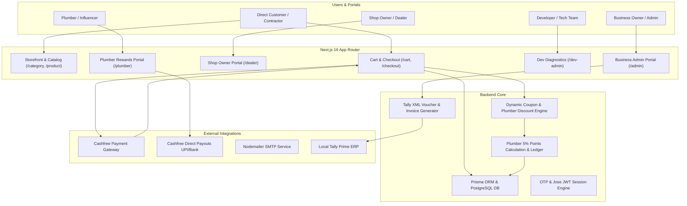

# KSTC E-Commerce Master Implementation & Execution Plan

A comprehensive, phased technical roadmap to build, test, secure, and deploy the full-scale hybrid B2B & B2C e-commerce platform for **Khatu Shyam Trading Co. (KSTC)**.

---

## Goal Description

Transform the existing KSTC prototype into an enterprise-ready, multi-role e-commerce and distribution platform. The platform serves three distinct customer segments:
1. **Authorized Dealers (Shop Owners)**: Stock replenishment at wholesale rates, local retail sales, dealer credit lines.
2. **Contractors**: Bulk project pricing, GST tax benefits, quotation/BOM requests.
3. **Direct Normal Customers**: Retail purchasing for individual residential construction/renovations with dynamic coupon discounts.

The platform includes:
* **High-Value Order Negotiation (> ₹20,000)**: Prior to checkout/payment, customers with carts exceeding ₹20,000 are prompted: *"Want any discount?"* and provided direct consultant contact (WhatsApp & phone). After negotiation, the consultant issues a custom coupon code applied at checkout.
* **Temporary System-Generated Bill**: Post-order, customers can download a temporary estimate bill. The system automatically emails this bill with the mandatory notice: *"this bill is system generated and temporary, your real bill will be sent to your provided email-id or mobile number soon"*.
* **Real Bill Upload & Instant Dispatch**: Business Owner / Admin can upload the official finalized Tax Invoice from `/admin`. The system emails it within seconds, and customer views/downloads it live on `/order-success` and `/orders` without page reload.
* **A Plumber Referral Scheme**: Plumbers earn 5% cash-convertible points on referred sales.
* **Cashfree Payment Gateway (Sandbox Mode)**: Web checkout for orders and automated payouts for plumber cash rewards.
* **Three Dedicated Dashboards**: Developer/Tech Team, Business Owner (Admin), and Shop Owner (Authorized Dealer).
* **Three User Profile Groups**: Normal/Contractor, Plumber, and Internal Administration & Workers.

---

## User Review & Architecture Clarifications

> [!IMPORTANT]
> **Cashfree Integration Mode**: Configured for **Sandbox Mode** (`https://sandbox.cashfree.com/pg` with test credentials). Supports simulated webhooks and live payment redirect sessions.

> [!IMPORTANT]
> **Billing Architecture (Tally Prime Dropped)**: Due to highly dynamic discount negotiations on bulk/project orders, Tally Prime direct billing has been replaced with:
> 1. **System-Generated Temporary Estimate Bill** (`/api/orders/[id]/temporary-bill`) downloadable immediately upon order placement and emailed automatically.
> 2. **Official Real Bill Upload & Dispatch Desk** in `/admin` where accounts staff upload finalized GST tax invoices (PDF/Image) which instantly trigger customer email notifications and live polling updates on `/order-success` and `/orders`.

> [!WARNING]
> **Database Schema Migration**: The current `schema.prisma` will be extended with new models (`PlumberProfile`, `ReferralTransaction`, `PayoutRequest`, `Coupon`, `StaffProfile`). Existing user and OTP data will be preserved without breaking migrations.

---

## System Architecture & Data Flow



---

## Phased Implementation Roadmap

```
Phase 1: Database & Schema Modernization (Profiles, Roles, Ledgers)
Phase 2: Storefront & Real Catalog Wiring (PostgreSQL Connection)
Phase 3: Dynamic Coupon Engine, Cart & Cashfree Payment Gateway
Phase 4: Plumber Scheme & Referral Rewards Engine (Points to Cash)
Phase 5: The Triple Dashboard Architecture (Dev, Admin, Dealer)
Phase 6: Tally Billing & Automated GST Invoicing
Phase 7: Testing, Security Hardening & Audit
Phase 8: Production Deployment, Monitoring & Post-Launch Ops
```

---

### Phase 1: Database Schema Expansion & Foundation

#### Objectives
1. Extend `prisma/schema.prisma` to support:
   * **Multi-Tier User Roles**: `RETAIL_CUSTOMER`, `CONTRACTOR`, `AUTHORIZED_DEALER`, `PLUMBER`, `ADMIN_SUPER`, `ADMIN_SALES`, `ADMIN_BILLING`, `STAFF_WAREHOUSE`.
   * **Plumber Profiles & Points Ledger**: Tracking plumber referral codes, points balance, payout requests.
   * **Coupons & Dynamic Discounts**: Coupon codes, percentage/fixed discounts, usage limits, role restrictions.
   * **Staff & Dealer Profiles**: Dealer credit limits, warehouse assignments, commission rates.
2. Build an automated database seed script (`prisma/seed.ts`) preloaded with the real product catalog (Sentini Flopipes, Polyworld Tanks, Johnson Pedders).

#### [MODIFY] `prisma/schema.prisma`
```prisma
// -----------------------------------------------------------------------------
// ENUMS
// -----------------------------------------------------------------------------
enum Role {
  RETAIL_CUSTOMER
  CONTRACTOR
  AUTHORIZED_DEALER
  PLUMBER
  ADMIN_SUPER
  ADMIN_SALES
  ADMIN_BILLING
  STAFF_WAREHOUSE
}

enum PayoutStatus {
  REQUESTED
  PROCESSING
  PAID
  REJECTED
}

enum DiscountType {
  PERCENTAGE
  FIXED_AMOUNT
}

// -----------------------------------------------------------------------------
// USER EXTENSIONS & PROFILES
// -----------------------------------------------------------------------------
model User {
  id            String    @id @default(cuid())
  name          String?
  email         String?   @unique
  phone         String?   @unique
  role          Role      @default(RETAIL_CUSTOMER)
  
  // Tagging to distinguish Normal Customer vs Contractor
  customerTag   String?   // "HOMEOWNER", "BUILDER", "EPC_CONTRACTOR"
  gstNumber     String?
  companyName   String?
  
  // Dealer Specific Fields
  shopName      String?
  tradeStatus   TradeStatus?
  creditLimit   Float?    @default(0)
  usedCredit    Float?    @default(0)
  
  // Plumber Referral Profile Link
  plumberProfile PlumberProfile?
  
  addresses     Address[]
  orders        Order[]
  quotes        Quote[]
  createdAt     DateTime  @default(now())
  updatedAt     DateTime  @updatedAt
}

model PlumberProfile {
  id              String                @id @default(cuid())
  userId          String                @unique
  user            User                  @relation(fields: [userId], references: [id], onDelete: Cascade)
  plumberCode     String                @unique // e.g. "PLUM-7840"
  totalPoints     Float                 @default(0)
  redeemedPoints  Float                 @default(0)
  activePoints    Float                 @default(0)
  upiId           String?
  bankAccountNumber String?
  bankIfsc        String?
  referrals       ReferralTransaction[]
  payoutRequests  PayoutRequest[]
  createdAt       DateTime              @default(now())
  updatedAt       DateTime              @updatedAt
}

model ReferralTransaction {
  id               String         @id @default(cuid())
  plumberId        String
  plumber          PlumberProfile @relation(fields: [plumberId], references: [id], onDelete: Cascade)
  orderId          String         @unique
  order            Order          @relation(fields: [orderId], references: [id])
  orderAmount      Float
  commissionRate   Float          @default(0.05) // 5% default point reward
  pointsEarned     Float
  status           PaymentStatus  @default(PENDING) // Credited once order is delivered
  createdAt        DateTime       @default(now())
}

model PayoutRequest {
  id               String         @id @default(cuid())
  plumberId        String
  plumber          PlumberProfile @relation(fields: [plumberId], references: [id], onDelete: Cascade)
  pointsRedeemed   Float
  cashAmount       Float          // 1 Point = ₹1 INR
  payoutStatus     PayoutStatus   @default(REQUESTED)
  cashfreeTransferId String?
  utrNumber        String?
  createdAt        DateTime       @default(now())
  updatedAt        DateTime       @updatedAt
}

model Coupon {
  id               String         @id @default(cuid())
  code             String         @unique
  description      String?
  discountType     DiscountType   @default(PERCENTAGE)
  discountValue    Float
  minOrderValue    Float          @default(0)
  maxDiscount      Float?
  validUntil       DateTime?
  usageLimit       Int?
  usageCount       Int            @default(0)
  allowedRoles     Role[]
  isActive         Boolean        @default(true)
  createdAt        DateTime       @default(now())
}
```

#### [NEW] `prisma/seed.ts`
* Populates all parent & subcategories (`Pipes & Fittings`, `Sanitary Ware`, `Water Storage Tanks`, `Bathroom Ware`).
* Seeds 25+ real SKUs with technical specifications, HSN codes (e.g. `3917` for CPVC/UPVC pipes, `6910` for vitreous sanitaryware), MRP, and dealer bulk tiers.
* Seeds default administrative and test dealer accounts.

---

### Phase 2: Storefront & Real Catalog Modernization

#### Objectives
1. Replace all mock in-memory arrays in `category/[slug]/page.tsx` and `product/[id]/page.tsx` with dynamic PostgreSQL queries.
2. Enable real category routing so clicking *"Pipes & Fittings"* only displays pipes and fittings.
3. Build the global header search with live autocomplete.
4. Implement product variant selectors (diameters: 1/2", 3/4", 1", 1.25", 2"; lengths: 3m, 5m).

#### Key Deliverables
* [NEW] [src/app/actions/catalog.ts](file:///c:/Users/Siddharth/Desktop/Projects/KSTC/KSTC-eCOM/src/app/actions/catalog.ts): Server actions for fetching paginated products, category hierarchies, filtered specifications, and search autocomplete.
* [MODIFY] [src/components/layout/Header.tsx](file:///c:/Users/Siddharth/Desktop/Projects/KSTC/KSTC-eCOM/src/components/layout/Header.tsx): Embed live search bar with instant dropdown preview (shows product thumbnail, MRP, and brand tag).
* [MODIFY] [src/app/(shop)/category/[slug]/page.tsx](file:///c:/Users/Siddharth/Desktop/Projects/KSTC/KSTC-eCOM/src/app/(shop)/category/[slug]/page.tsx): Connect filters (brand, material, price range) directly to database query parameters.
* [MODIFY] [src/app/(shop)/product/[id]/page.tsx](file:///c:/Users/Siddharth/Desktop/Projects/KSTC/KSTC-eCOM/src/app/(shop)/product/[id]/page.tsx): Add multi-angle image gallery, PDF technical datasheet download button, and dynamic stock badge (`In Stock`, `Low Stock`, `Available for Truck Dispatch`).

---

### Phase 3: Dynamic Coupon Engine, Cart & Cashfree Payment Gateway

#### Objectives
1. Build a dynamic discount engine supporting:
   * Standard promo coupons (e.g. `KSTCNEW5`, `FESTIVE10`).
   * Plumber referral discounts (e.g., entering Plumber's mobile number or Code `PLUM-XXXX` applies on-the-spot discount).
   * Contractor GST tax relief / volume threshold discounts.
2. Integrate **Cashfree Payments (PG)**:
   * Client-side checkout with `@cashfreepayments/cashfree-js`.
   * Server-side order creation with `cashfree-pg`.
   * Secure webhook handler verifying HMAC-SHA256 signature to transition orders from `PENDING` to `CONFIRMED`.
3. Delivery vs Warehouse Pickup toggle:
   * Pick up at Maharajpura showroom (₹0 shipping fee).
   * Local truck dispatch across Gwalior & Chambal region.

#### Key Deliverables
* [NEW] [src/lib/cashfree.ts](file:///c:/Users/Siddharth/Desktop/Projects/KSTC/KSTC-eCOM/src/lib/cashfree.ts): Cashfree SDK initialization for Sandbox & Production.
* [NEW] [src/app/actions/coupon.ts](file:///c:/Users/Siddharth/Desktop/Projects/KSTC/KSTC-eCOM/src/app/actions/coupon.ts): Dynamic coupon validation server action verifying user role, minimum cart value, and plumber referral link.
* [NEW] [src/app/api/webhooks/cashfree/route.ts](file:///c:/Users/Siddharth/Desktop/Projects/KSTC/KSTC-eCOM/src/app/api/webhooks/cashfree/route.ts): Webhook endpoint processing `ORDER_PAID`, `PAYMENT_FAILED`, and updating order states in PostgreSQL.
* [MODIFY] [src/app/(shop)/checkout/page.tsx](file:///c:/Users/Siddharth/Desktop/Projects/KSTC/KSTC-eCOM/src/app/(shop)/checkout/page.tsx): Add coupon input box, plumber referral ID box, delivery type toggle, and Cashfree Drop-in UI modal.

---

### Phase 4: Plumber Scheme & Referral Rewards Engine

#### Objectives
1. Allow plumbers to register or get registered with a dedicated **Plumber Profile**.
2. Automatically generate unique Plumber Code (`PLUM-XXXX`) and QR Code.
3. Referral tracking:
   * When a customer makes a purchase using the Plumber Code/Mobile Number:
     * Customer receives the active on-time discount.
     * Plumber's ledger receives `order_total * 0.05` points (1 point = ₹1 INR).
4. Plumber Rewards Portal (`/plumber/rewards`):
   * View total referred sales and earned points.
   * "Convert to Cash" button: Initiates direct UPI/Bank transfer via Cashfree Payouts API.

#### Key Deliverables
* [NEW] [src/app/actions/plumber.ts](file:///c:/Users/Siddharth/Desktop/Projects/KSTC/KSTC-eCOM/src/app/actions/plumber.ts): Plumber registration, code lookup, points balance check, and withdrawal request submission.
* [NEW] [src/app/(shop)/plumber/rewards/page.tsx](file:///c:/Users/Siddharth/Desktop/Projects/KSTC/KSTC-eCOM/src/app/(shop)/plumber/rewards/page.tsx): Mobile-friendly plumber rewards wallet, passbook statement, and withdrawal modal.

---

### Phase 5: The Triple Dashboard Architecture

#### Dashboard 1: Developer / Tech Team Dashboard (`/dev-admin`)
* **Target Audience**: Technical architects, system engineers.
* **Features**:
  * Real-time database pool status (`pg_stat_activity`, active connections).
  * Cashfree API connection health & webhook delivery logs.
  * Nodemailer SMTP latency & dispatch error queue.
  * System cache status & 1-click catalog cache revalidation.
  * Environment variable diagnostics & runtime audit.

#### Dashboard 2: Business Owner (Admin) Dashboard (`/admin`)
* **Target Audience**: KSTC Directors, Business Owners, Operations Managers.
* **Features**:
  * Real-time revenue, order volume, and gross margin analytics.
  * **Dealer Approval Queue**: Review shop GSTIN, assign credit limits (`creditLimit`), approve/reject trade accounts.
  * **Plumber Referral Desk**: Audit plumber commissions, approve bulk cash payouts, monitor top-performing plumbers in Gwalior.
  * **Inventory & Price Manager**: Update stock counts, batch-adjust bulk price tiers.
  * **Coupon & Promotions Engine**: Create festive promo codes, configure referral discount percentages.
  * **Staff Management**: Assign roles (`ADMIN_SALES`, `ADMIN_BILLING`, `STAFF_WAREHOUSE`).

#### Dashboard 3: Shop Owner (Authorized Dealer) Dashboard (`/dealer`)
* **Target Audience**: Retail plumbing store owners buying wholesale from KSTC.
* **Features**:
  * **Wholesale Restock Desk**: 1-click reorder of standard pipe bundles and fittings at authorized dealer pricing.
  * **Dealer Credit Line**: Track used credit vs sanctioned limit, invoice due dates, and payment history.
  * **Local Counter Billing**: Quick-bill local walk-in customers and print branded KSTC dealer invoices.
  * **Plumber Referral Tagging**: Tag local plumber who brought in a walk-in customer so the plumber automatically gets their 5% reward points.

---

### Phase 6: Tally Prime Billing Integration & GST Invoicing

#### Objectives
1. Generate 100% compliant **Tally XML Sales Vouchers** for all confirmed orders.
2. Support Indian GST standards:
   * Intra-state MP supply: CGST (9%) + SGST (9%).
   * Inter-state supply: IGST (18%).
   * HSN Code classification (Chapter 39 for Plastics/Pipes, Chapter 69 for Ceramic Sanitaryware).
3. Provide two sync mechanisms:
   * **1-Click Batch Export**: Download `tally-sales-vouchers-YYYY-MM-DD.xml` from the Admin Dashboard for direct drag-and-drop into Tally Prime.
   * **Live REST Sync Endpoint**: `/api/v1/integrations/tally/sync` for automated Tally ODBC/XML server polling.

#### Key Deliverables
* [NEW] [src/lib/tally.ts](file:///c:/Users/Siddharth/Desktop/Projects/KSTC/KSTC-eCOM/src/lib/tally.ts): XML serialization helper compliant with Tally Prime `<TALLYMESSAGE xmlns:UDF="TallyUDF">` schemas.
* [NEW] [src/app/actions/tally.ts](file:///c:/Users/Siddharth/Desktop/Projects/KSTC/KSTC-eCOM/src/app/actions/tally.ts): Server action to generate XML vouchers for any date range or order batch.
* [NEW] [src/app/api/invoice/[orderId]/route.ts](file:///c:/Users/Siddharth/Desktop/Projects/KSTC/KSTC-eCOM/src/app/api/invoice/[orderId]/route.ts): Printable GST tax invoice with KSTC GSTIN, customer GSTIN, HSN codes, and digital signature stamp.

---

### Phase 7: Testing, Security Hardening & Audit

#### Automated Testing Suite
* **Unit Tests (Jest)**:
  * Plumber referral point calculations (`order_amount * 0.05`).
  * Coupon discount validation rules (expired dates, minimum cart value, role checks).
  * GST tax calculations (CGST/SGST vs IGST).
* **Integration Tests (Playwright / Vitest)**:
  * Full customer checkout flow: Cart ➔ Coupon applied ➔ Cashfree session created.
  * Plumber registration and referral code lookup.
  * Role-based middleware enforcement (Dealer cannot access Dev dashboard; unauthenticated user blocked from `/account`).

#### Security Hardening & Pre-Flight Checks
* **OWASP Top 10 Mitigation**:
  * Input sanitization on all form fields with Zod schema validation.
  * SQL injection immunity via Prisma parameterization.
  * Cashfree Webhook Signature validation using HMAC-SHA256 to prevent payment spoofing.
  * Strict rate limiting on OTP requests (Upstash Redis or in-memory sliding window).
  * CORS & Security Headers: `Content-Security-Policy`, `X-Frame-Options: DENY`, `X-Content-Type-Options: nosniff`.

---

### Phase 8: Deployment, Post-Production & Operational Setup

#### Production Infrastructure
* **Hosting**: Vercel Production Environment connected to main Git branch.
* **Database**: Managed PostgreSQL on Neon / Supabase with Connection Pooling (`pgbouncer=true`).
* **Environment Configuration**:
  * Production Cashfree credentials (`CASHFREE_APP_ID`, `CASHFREE_SECRET_KEY`, `CASHFREE_ENVIRONMENT=PRODUCTION`).
  * Production Nodemailer SMTP credentials for transactional emails.
  * Production `AUTH_SECRET` (256-bit cryptographic key).

#### Post-Production Works & Maintenance
* **Vercel Analytics & Error Monitoring**: Sentry integration for real-time frontend and backend error tracing.
* **Automated Database Backups**: Daily automated snapshots with 30-day retention.
* **SLA & Uptime Monitoring**: Health check endpoint `/api/health` monitored via BetterUptime or UptimeRobot.
* **Dealer & Plumber Onboarding Material**: Printable PDF flyers with QR codes for Gwalior retail shops.

---

## Verification Plan

### Automated Tests
* Run unit and integration tests:
  ```powershell
  npm run test
  ```
* Run linter and build check:
  ```powershell
  npm run lint
  npm run build
  ```

### Manual Verification Flows
1. **Direct Customer Order Flow**:
   * Add pipe and basin to cart.
   * Enter a test coupon code (e.g. `WELCOME10`) ➔ verify discount is reflected.
   * Proceed to checkout, select Cashfree test payment ➔ verify order lands in `/order-success` and is recorded in PostgreSQL.
2. **Plumber Referral Flow**:
   * Sign in as Plumber ➔ check unique code (e.g. `PLUM-101`).
   * As normal customer, place order entering `PLUM-101` ➔ complete order.
   * Sign in back as Plumber ➔ verify 5% points credited to active balance.
   * Request payout ➔ verify transaction status in Admin dashboard.
3. **Dashboard Access Validation**:
   * Sign in as Developer ➔ verify `/dev-admin` loads system metrics.
   * Sign in as Dealer ➔ verify `/dealer` shows wholesale replenishment catalog and credit limit.
   * Sign in as Retail User ➔ verify `/admin` and `/dealer` redirect to home.
4. **Tally Export Verification**:
   * In Admin dashboard, navigate to Tally Export ➔ download XML batch.
   * Verify XML structure contains correct Ledger names (`Sales @ 18%`, `CGST @ 9%`, `SGST @ 9%`), HSN codes, and party details.
